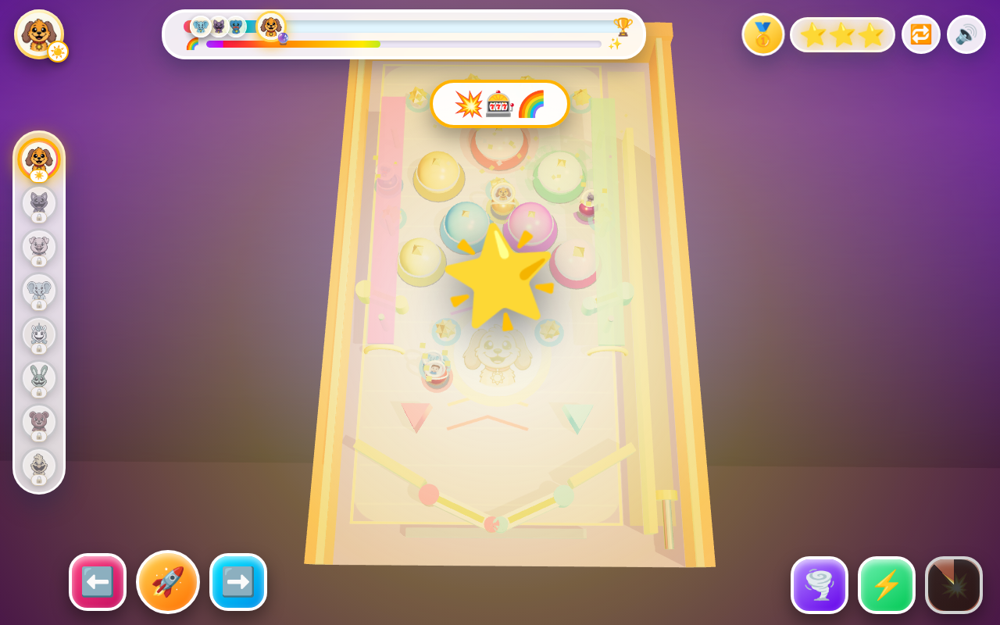

# 🎰 Critter Pinball 3D: Rainbow Arcade Bumper Table! (`critters-pinball3d`)

**Play Live**: https://kunruiw1991.github.io/critters-pinball3d/  
**Repository**: https://github.com/kunruiw1991/critters-pinball3d

---

## 🌈 Overview & 3D WebGL Pinball Engine Highlights

**Critter Pinball 3D: Rainbow Arcade Bumper Table!** is a 100% Zero-Text, kid-friendly **3D WebGL Tilted Pinball Machine & Bumper Table** powered by **Three.js r161** (`THREE.WebGLRenderer`, `PCFSoftShadowMap`, `ACESFilmicToneMapping`, `SRGBColorSpace`, and procedural `PMREMGenerator` studio reflections).

### Core 3D Gameplay & Physics Mechanics
- **Tilted 3D Pinball Cabinet & Playfield**: Custom down-slope pinball gravity (`+z` slope), curved top rebound arch, right-side **Spring Plunger Shooter Lane** (`🚀`), dual upper & lower **3D Neon Flippers** (`⬅️` / `➡️`) with real 2D swept circle-vs-capsule collision physics, and a glowing **Rainbow Auto-Save Shield Bar** so young players never suffer frustrating ball-drain game-overs.
- **7 Giant 3D Mushroom Pop Bumpers**: Colorful 3D mushroom domes with chrome stems, glowing LED skirts, contact shadows, and spinning golden star crowns that flash white on impact, squash-and-stretch, bounce the metallic Critter ball with high-velocity radial impulse, spawn pooled 3D shockwave rings + 3D spark bursts, and pulse the playfield lights.
- **2 Neon Slingshot Kickers, 2 Elevated 3D Ramp Rails & 10 Spinning 3D Star Targets**: Launch the metallic Critter pinball airborne up elevated neon ramps (`y = 2.55`) supported by chrome pillars for Ramp Jackpots and spin golden star targets to charge the **Rainbow Fever (`🌈`)** meter.
- **14 Smiling Critter Icons & 5-Critter Live Tournament**: Watch your metallic Critter Pinball (topped with a camera-tilted sRGB portrait medallion and glowing halo) compete simultaneously against **4 Rival Critter Pinballs** (featuring all 8 table Critters plus 6 bonus rivals: `huggy`, `jj`, `lunabat`, `mikey`, `poppydash`, and `sunnyfox`) on the playfield and along the Top Tournament Scoreboard Bar!

---

## 🐾 8 Selectable Smiling Critters & Themed 3D Pinball Tables

1. ☀️ **DogDay** — *Sunny Gold Arcade Table* (`icons/dogday.jpg`)
2. 🌙 **CatNap** — *Dreamy Lavender Starlight Table* (`icons/catnap.jpg`)
3. 🍎 **PickyPiggy** — *Candy Berry Sweet Bumper Table* (`icons/picky.jpg`)
4. 💡 **BubbaBubbaphant** — *Cyber Neon Sky Table* (`icons/bubba.jpg`)
5. 🎨 **CraftyCorn** — *Rainbow Prism Studio Table* (`icons/craftycorn.jpg`)
6. ⚡ **HoppyHopscotch** — *Emerald Turbo Bolt Table* (`icons/hoppy.jpg`)
7. 💖 **BobbyBearHug** — *Rose Heart Loveland Table* (`icons/bobby.jpg`)
8. 🛹 **KickinChicken** — *Golden Halfpipe Extreme Table* (`icons/kickin.jpg`)

---

## 🎮 Controls & 3 Interactive Power Pedals (100% Zero-Text Cockpit)

- **Left Flipper (`⬅️`)**: `ArrowLeft`, `Z`, `A`, tap left half of screen, or hold `#btnFlipperLeft` (multi-pointer tracked)
- **Right Flipper (`➡️`)**: `ArrowRight`, `M`, `D`, tap right half of screen, or hold `#btnFlipperRight` (multi-pointer tracked)
- **Spring Plunger Launch (`🚀`)**: `ArrowUp`, `W`, `Enter`, or tap `#btnPlungerLaunch` (launches balls inside the right shooter lane)
- **3 Cooldown Power Pedals (with Two-Phase Active Gold Ring + Post-Active Cooldown Sweep)**:
  1. 🧲 **Magnet Flipper & Bumper Vortex (`Key 1` / `#btnPedalMagnet`, 4.5s active / 9s total cooldown)**: Summons a glowing 3D purple vortex ring cluster around `(-0.8, -8.5)` with damped tangential swirl that cancels slope gravity and orbits your pinballs through the upper mushroom bumper cluster.
  2. ⚡ **Multiball Fever (`Key 2` / `Space` / `#btnPedalMultiball`, 7.2s active / 15s total cooldown)**: Spawns 2 extra glowing Rainbow Multiballs at verified collider-clear upper-playfield positions (`7.2s` duration, auto-expiring with a particle poof) and triggers **Rainbow Fever (`🌈`)** while preserving any pre-existing natural Fever charge!
  3. 💥 **Table Tilt Quake (`Key 3` / `#btnPedalTiltQuake`, 7s cooldown)**: Physically rocks and lifts the 3D pinball cabinet (`tableGroup.rotation.z` & `position.y`) with a rainbow shockwave, popping all 7 mushroom bumpers and spinning rival balls with 3D dizzy star halos (`55%` pace for `2.0s`)!

---

## 🏆 Strict 5-Critter Podium & Top-3 Qualification Rules

| Finish Rank | Medal | Stars Awarded | Stage Qualification Outcome |
| :---: | :---: | :---: | :--- |
| **1st Place** | 🥇 | ⭐⭐⭐ (`3⭐`) | **Stage Cleared!** Unlocks next pinball table (`▶️` enabled) |
| **2nd Place** | 🥈 | ⭐⭐ (`2⭐`) | **Stage Cleared!** Unlocks next pinball table (`▶️` enabled) |
| **3rd Place** | 🥉 | ⭐ (`1⭐`) | **Stage Cleared!** Unlocks next pinball table (`▶️` enabled) |
| **4th / 5th Place** | 😭 | ❌ (`0⭐`) | **Defeat!** Does **NOT** unlock next stage (`🔁` Retry only, `▶️` hidden) |

---

## 🧪 Iterative QA & Testing Changelog

- **Iteration 1**:
  - Calibrated Three.js r161 physically-based lighting (`DirectionalLight` intensity `3.8` with `2048x2048` `PCFSoftShadowMap`, `PointLight` with `decay: 1.0`, procedural `PMREMGenerator` studio environment map, `SRGBColorSpace` + mipmapped anisotropic portrait textures, and high-contrast arcade playfield `CanvasTexture`).
  - Pooled all 3D particles (`PARTICLE_MESH_POOL`) and shockwave rings (`SHOCKWAVE_MESH_POOL`) with deep `disposeObject3D()` on stage rebuilds for zero GPU geometry/material leaks.
  - Replaced box-based flipper/plunger impulses with swept 2D circle-vs-capsule flipper collision and shooter-lane-only plunger launches; added multi-pointer `setPointerCapture` flipper tracking so flippers never stick raised.
  - Added `e.repeat` guards, pedal cooldowns (`9s` / `15s` / `7s`) with conic-gradient cooldown sweeps, auto-expiry of extra multiballs, and balanced tournament pacing so idle runs finish 4th/5th while active play competes for Top 3.
  - Added responsive camera framing and `@media` layouts for desktop (`1280x800`), phone portrait (`390x844`), and phone landscape (`844x390`).
- **Iteration 2**:
  - Added procedural WebAudio arcade sound synthesizer (flipper snap, plunger spring whoosh, pitch-escalating bumper pop, star chime, ramp jackpot fanfare, magnet hum, multiball arpeggio, tilt quake boom, cooldown deny buzz, and podium victory/defeat jingles) with persistent `🔊`/`🔇` toggle.
  - Added screen-space combo/impact bursts, pedal ready pop (`1.26x`) and denied red wiggle feedback (`0.36s`) on cooldown presses.
- **Iteration 3**:
  - Upgraded 3D camera trauma shake (`addTrauma`) applied post-lerp to both camera position and lookAt target plus post-`lookAt` angular shake (`rotateX/Y/Z`) using multi-frequency sine noise (`23/37/51 Hz`).
  - Implemented true 3D reflection + knockback impulses on mushroom bumpers (`v' = v - (1+e)(v·n)n + n·kick`, `vy = 3.5`), mass-weighted ball-vs-rival Clash (`m ∝ r³`), flipper angular velocity `ω = (angle - prevAngle)/dt` with `ω·t·L` contact strike and static-wall (`e = 0.3`) cradling, quaternion sphere rolling (`_rollQuat`), 128-particle pool with white core flash, 24-shockwave pool with `0.12s` delayed thin second ring, real star target colliders (`r = 0.95`), and 24-pool Flying Star Coins along a quadratic Bézier arc to `#playerMarker`.
- **Iteration 4**:
  - Redesigned the 100% Zero-Text kid-friendly cockpit with giant corner two-thumb flippers (`⬅️` bottom-left, `➡️` + `🚀` bottom-right), centered power pedals (`🧲`, `⚡`, `💥`), responsive 2-column landscape podium (`<= 325px`), flexible portrait standings/finale grid, 3s rival start grace period, gentle amber catch-up cue (`⬆️`), flame-gold Fever bar, `0.6s` hold-to-confirm protection on `🔁` and mid-game table switches, landscape `🗺️` drawer, and full `contextmenu` blocking.
- **Iteration 5**:
  - Replaced Rainbow Fever's step-flashing light with smooth constant-luminance HSL hue rotation (`0.35 Hz`, intensity `55 ± 2.5`), preserved pre-existing natural Fever charge across `⚡` Multiball Fever boosts, raised natural Fever fill (`0.135` per base point) for 2–3 natural Fevers per table, added live Fever bar countdown drainage, and added 3D rainbow ball halos + rainbow trail sparks during Fever.
  - Added a 3D spinning purple Magnet Vortex mesh group at `(-0.8, -8.5)` with damped swirling vortex physics that cancels slope gravity, collider-clear Multiball spawn validation, real 3D `tableGroup` Tilt Quake cabinet rock/hop animation, two-phase pedal rings (draining gold active ring followed by 100%->0% post-active cooldown sweep), separate flipper vs pedal activity windows, modal/post-race input guards, and keyboard `.pedal-pressed` visual feedback.
- **Iteration 6**:
  - Replaced flat rival score rates with a kid-friendly Stage 1–8 calibrated difficulty multiplier curve (`[0.76, 0.85, 0.92, 0.98, 1.04, 1.10, 1.16, 1.22]`) and gentle adaptive rubber-banding when the player is actively flipping on early tables so Stage 1 guarantees a joyful 3-star onboarding win while Stages 2–8 ramp up progressively.
  - Gave each of the 4 AI rival pinballs a distinct playfield AI archetype (`bumper_hunter`, `ramp_sprinter`, `spinner_ace`, and `steady_cruiser`) with periodic steering impulses so rivals visibly weave through bumpers, ramps, and star targets.
- **Iteration 7**:
  - Locked true `finishOrder` the instant any racer crosses `targetScore`, stopped rival score accumulation once finished, and updated `computeStandings()` and `forceFinishAtRank()` to sort finished racers strictly by `finishOrder` ascending before comparing scores.
  - Added stepped Top-3 podium pedestal heights (`.rank-1`, `.rank-2`, `.rank-3` vs `.rank-out`) and a prominent pulsing Retry (`🔁`) animation on `.podium-card.lose-card` for 4th/5th-place (`0⭐`) Sad Defeat.
  - Enforced strict `(cupStars[idx - 1] || 0) >= 1` qualification in `isWorldUnlocked(idx)` and updated the modal `keydown` handler to check `!DOM.btnWinNext.classList.contains('hidden')`.
- **Iteration 8**:
  - Upgraded the procedural Web Audio synthesizer with a master `GainNode` + `DynamicsCompressorNode` anti-clipping bus, sample-accurate `audioCtx.currentTime + delaySec` scheduling across all arpeggios/fanfares, `osc.onended` node cleanup, and a `25ms` minimum re-trigger interval to prevent distortion during Multiball bumper bursts.
  - Added a shimmering ascending `playRainbowFeverChimeSfx()` when Rainbow Fever triggers naturally at 100% gauge, and enriched `playLoseSadSfx()` with a held `0.65s` descending trombone slide on the 4th note.
  - Compacted stepped `.standing-slot` heights in `@media (max-height: 500px)` so `#winPodiumCard` stays `<= 325px` tall on `844x390` landscape phones, and tucked `.world-selector-rail` into the `🗺️` drawer on `390x844` portrait phones so the 3D cabinet left rail is never crowded.
- **Iteration 9**:
  - Added `clearTimeout(finishPinballTournament._modalTimer)` at the start of `buildPinballTableWorld()`, shared the dizzy-star material with `keepAlive: true`, and reset mesh scale/opacity in `recycleAllPooledEffects()`.
  - Added an anti-stuck dead-spot velocity watchdog (`ball.stuckTimer`) in `stepSingleBallPhysics()` that pops any playfield ball wedged at `< 1.8 u/s` for `> 0.8s` free with a lively upward hop, plus `visibilitychange` and `resize` `devicePixelRatio` handling.
- **Iteration 10**:
  - Completed final 10-round Critic-Creator verification across desktop (`1280x800`), phone portrait (`390x844`), and phone landscape (`844x390`), captured live `1280x800` 3D WebGL preview (`screenshot.jpg`), and deployed to GitHub Pages.

---

## 🤖 Automated QA & Headless Chrome Testing API (`window.gameTestApi`)

- `window.gameTestApi.getState()` — Returns live stage index, `stageUnlocked` array, `score`, `targetScore`, `rank`, `projectedStars`, `rainbowFever`, `feverMeter`, `activeBalls`, `bumperHits`, `comboCount`, `cooldowns`, `cupStars`, and `standings`.
- `window.gameTestApi.flipLeft()` / `window.gameTestApi.flipRight()` / `window.gameTestApi.launchPlunger()` — Triggers flipper snaps and spring plunger launch.
- `window.gameTestApi.triggerPedal(0 | 1 | 2)` — Activates `🧲 Magnet`, `⚡ Multiball Fever`, or `💥 Table Tilt Quake`.
- `window.gameTestApi.selectStage(0..7)` — Rebuilds the 3D pinball cabinet for Stage `0..7`.
- `window.gameTestApi.forceFinish(1..5)` — Deterministically finishes the current tournament at Rank `1..5` to verify Top-3 (`3⭐`/`2⭐`/`1⭐`) stage unlock vs. 4th/5th (`0⭐`) Sad Defeat rules.

